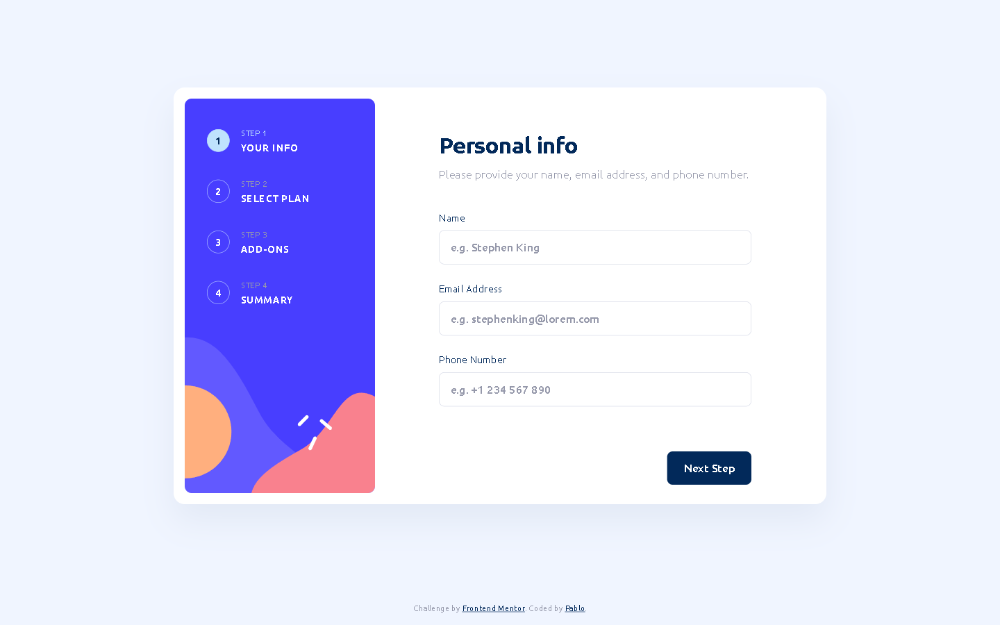

# Multi-step form — Frontend Mentor



A four-step subscription form: personal details, plan, add-ons, summary, confirmation.
Built with Vite + TypeScript and hand-written CSS. No UI framework, no CSS framework.

## Run it

Requires Node 20.19+ or 22.12+ (Vite 8).

```bash
npm install
npm run dev      # http://localhost:5173
npm run build    # type-check + production build
npm run preview  # serve the build
npm test         # 38 unit tests (Vitest)
```

## How it is put together

```
src/
├── model/       pure logic, zero DOM
│   ├── types.ts        OrderState and friends
│   ├── catalog.ts      plans and add-ons with both prices
│   ├── pricing.ts      totals, formatting
│   ├── validation.ts   profile and per-step rules
│   └── navigation.ts   Next / Back / Change / Confirm decisions
├── ui/          one module per region, DOM in and out
├── styles/      tokens, reset, base, layout, components, utilities
└── main.ts      the state object, the render loop, event delegation
```

### One state object, one render

```ts
interface OrderState {
  nav: { step: StepIndex; returnTo: StepIndex | null };
  billing: 'monthly' | 'yearly';
  plan: PlanId | null;
  addons: ReadonlySet<AddonId>;
  profile: { name: string; email: string; phone: string };
}
```

Every event follows the same path: read the DOM, ask the model what should happen,
replace the state, render. The functions in `model/navigation.ts` are pure and
return both the next `nav` and where focus should land, which is what makes the
"edit from the summary" flow testable without a browser.

Text inputs are one-way (`DOM → state`). `render()` never writes `input.value`,
so the caret never jumps to the end mid-typing.

### Validation

Errors are derived from the state on every render, never stored. They are only
shown once the user has tried to leave a step (`attempted`), so nothing turns red
while typing the first character, and they disappear as soon as the value is fixed.

The email rule is deliberately permissive (`something@something.tld`): the goal is
to catch obvious typos, not to reimplement RFC 5322. `type="email"` stays on the
input for the keyboard and autofill, but validation is ours.

The phone number is required and nothing else. A format regex rejects valid
international numbers.

### Layout

A single structural breakpoint at `48rem`.

- **Desktop**: the card is 940×600, matching the JPG pixel for pixel; the sidebar
  is the 274×568 asset. Every step is exactly 600px tall, so the card does not
  jump when you move between steps.
- **Mobile**: 172px banner, the card overlaps it by 68px, and the action bar is
  fixed to the bottom so the primary button is always reachable with a thumb.

Sizes that scale between the two (`--content-inline`, `--sidebar-width`,
`--banner-height`) are `clamp()` values rather than extra breakpoints.

## Accessibility

- Native radios and checkboxes inside real `<label>`s. The custom visuals come from
  `appearance: none` plus `:has(:checked)`, so the input keeps its semantics,
  keyboard behaviour and form association.
- The billing switch is a real `<input type="checkbox" role="switch">` with a
  separate thumb element — Firefox does not render pseudo-elements on `<input>`.
- Focus moves on every step change: to the new `h2[tabindex="-1"]` when navigating,
  to the first invalid control when validation fails. The ring appears for keyboard
  users only.
- Errors are linked with `aria-describedby` and `aria-invalid`; a visually hidden
  `role="status"` region announces the error count when focus cannot do the job.
- The two "Change" links are "Change personal details" and "Change plan" to a
  screen reader, so they are distinguishable out of context (WCAG 2.5.3).
- Colour is never the only signal: the focus ring is 2px, offset, and survives
  200% zoom and `forced-colors`.
- `prefers-reduced-motion` turns off the transitions.
- The Ubuntu weights are subset to Latin + Latin-1 + Latin Extended-A and served
  as woff2: 855 kB of TTF becomes 121 kB, preloaded with `font-display: swap`.

## Deliberate deviations from the designs

1. **The summary lists the contact details**, with a second Change link. The JPGs
   only show the plan there; showing what was entered is the point of a summary.
2. **The primary button reads "Update"** while editing from the summary, and both
   Next and Go Back return to the summary instead of walking the wizard again.
3. **The total has no "+"**. The monthly JPG has one, the yearly JPG does not;
   the add-on rows keep it, the total is a total.
4. **"Arcade (Yearly)"**. The yearly JPG says "(Monthly)" next to a yearly price.
5. **Mobile inputs are 48px tall** instead of the ~38 in the design, to keep a
   comfortable touch target.
6. **Plan labels are not truncated**: the sidebar labels never wrap at any width.

## Tests

`npm test` runs 38 tests over the model:

- the catalogue invariant `yearly === monthly * 10` for every plan and add-on;
- `attempted` is never mutated in place;
- editing a step returns to the summary, and a failed edit keeps you on the step;
- the email regex accepts and rejects a table of realistic addresses;
- confirming with an inconsistent state jumps to the offending step.

The DOM layer is verified by hand at 1440, 768, 375 and 320px wide.

## What I would add next

- Persistence (`sessionStorage`) so a refresh does not lose the order.
- A Playwright suite for the five-step happy path plus the three error states.
- Hash routing (`#step-3`) for back-button support.
- A real endpoint behind Confirm.
